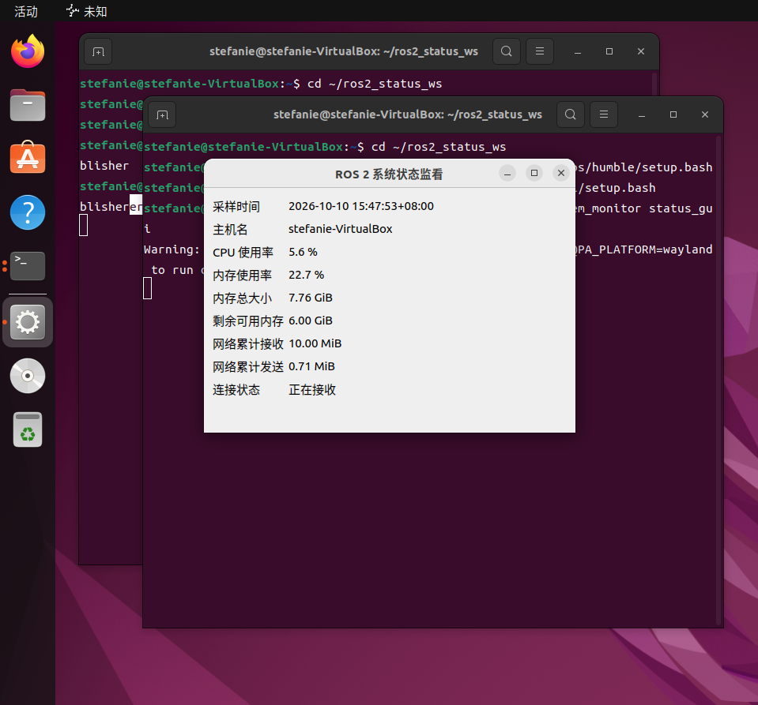

# ROS 2 系统状态监控

目标环境：Ubuntu 22.04 + ROS 2 Humble，使用系统 Python 3。

## 两个包的职责
- status_interfaces：定义 SystemStatus 自定义消息。
- system_monitor：包含采集发布节点 status_publisher 和 Qt 订阅窗口 status_gui。
- 数据经 /system_status 话题传递，每秒采样一次。

## 安装依赖
```bash
sudo apt update
sudo apt install python3-psutil python3-pyqt5 python3-colcon-common-extensions
```

## 编译
在项目根目录（有 src 文件夹的目录）执行：
```bash
source /opt/ros/humble/setup.bash
colcon build --symlink-install
source install/setup.bash
```
预期构建摘要包含 2 packages finished；若报错请先排查，不要继续运行。

## 运行
终端一（保持运行；没有持续输出也正常）：
```bash
cd ~/ros2_status_ws
source /opt/ros/humble/setup.bash
source install/setup.bash
ros2 run system_monitor status_publisher
```
终端二：
```bash
cd ~/ros2_status_ws
source /opt/ros/humble/setup.bash
source install/setup.bash
ros2 run system_monitor status_gui
```
界面显示采样时间、主机名、CPU 使用率、内存使用率、总内存、可用内存、累计网络接收与发送量，并显示连接状态。
停止采集节点超过 3 秒后，界面应提示“超过 3 秒未收到数据”；重新启动采集节点应恢复。
关闭窗口退出 GUI；Ctrl+C 停止发布节点。

## 验证数据
在第三个终端进入同一目录并 source 上述两个环境文件后执行：
```bash
ros2 topic echo /system_status --once
```
预期输出 8 个顶层字段；stamp 内部含 sec 和 nanosec。
网络计数是累计字节数，不是实时网速；内存 available 是可供程序使用的内存。
1 GiB = 1024**3 字节；1 MiB = 1024**2 字节。
虚拟机中显示的是 Ubuntu 所见的资源，不一定与 Windows 任务管理器一致。

## 提交到 GitHub
只上传 src、README.md、.gitignore 等项目源文件；不要上传 build、install、log。
仓库按题目要求设为 Public，建议补充真实运行截图。
package.xml 和 setup.py 中 student / student@example.com 是占位维护者信息，提交前替换为你愿意公开的姓名和邮箱。
包元数据声明 Apache-2.0。

## 验证范围
## 运行验证

已在 VirtualBox 中的 Ubuntu 22.04 + ROS 2 Humble 环境完成以下验证：

- 官方 talker/listener 示例通信正常。
- 两个 ROS 2 包编译成功，构建结果为 `2 packages finished`。
- 系统状态采集节点与 Qt 显示节点成功运行。
- 界面能够接收并显示采样时间、主机名、CPU 使用率、内存信息和网络累计收发量。

## 运行截图



